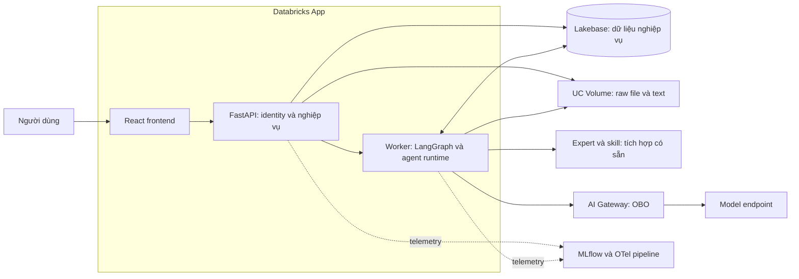
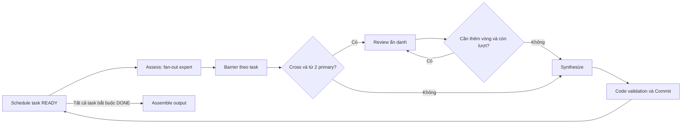

# DPrism — Backend API & Database: MVP1 Architecture

**Trạng thái:** Draft để review kiến trúc tổng thể. **Ngày:** 2026-10-27. **Phạm vi:** template discussion và chat riêng.

Tài liệu tổng hợp các quyết định đã chốt trong phiên grilling. Các lựa chọn triển khai chưa được chốt được ghi là **đề xuất**; chưa phải đặc tả chi tiết hoặc yêu cầu implement ngay.

## Problem Statement

Frontend hiện chạy được các luồng nghiệp vụ bằng mock, nhưng chưa có nơi lưu dữ liệu dùng chung, gọi model thật hoặc thực thi plan bền vững. Người dùng cần chạy case từ template, trò chuyện riêng với expert và mở lại kết quả mà không phụ thuộc trình duyệt đang mở.

Backend phải biết chính xác mỗi lần chạy đã dùng plan, expert, skill và tài liệu nào; chạy song song các công việc độc lập; kiểm soát vòng lặp và thời gian. Database lưu dữ liệu nghiệp vụ, còn log và trace sử dụng MLflow/OpenTelemetry.

## Solution

Triển khai React và Python/FastAPI trong **Databricks Apps**, dùng **LangGraph** thực thi, **Lakebase** lưu dữ liệu và checkpoint, **Unity Catalog Volume** lưu file gốc cùng text đã trích xuất. Model được gọi qua AI Gateway bằng **OBO**.

**Đề xuất kiến trúc:** một backend chia module theo trách nhiệm, gồm API và execution worker trong cùng deployment ban đầu. Worker nhận công việc từ hàng chờ bền vững trong Lakebase; request HTTP không giữ toàn bộ vòng đời thực thi. Có thể tách worker thành deployment riêng sau này mà giữ nguyên domain và API.

Expert/skill là năng lực có sẵn: chỉ sử dụng điểm tích hợp hiện hữu, **không thiết kế lại schema, ingestion hoặc CRUD của nguồn này**. Sơ đồ mô tả kết nối logic, không giả định nguồn đó là một service mới.

## User Stories

1. Là người dùng, tôi muốn chọn template có phiên bản để bắt đầu với quy trình có sẵn.
2. Là người dùng, tôi muốn chỉnh bản plan của case trước khi chạy mà không thay đổi template gốc.
3. Là người dùng, tôi muốn bổ sung PDF có text, TXT hoặc Markdown bên cạnh tài liệu của template để expert có đủ đầu vào.
4. Là người dùng, tôi muốn xem DAG đang chạy và kết quả từng bước mà không phải điều phối expert.
5. Là người dùng, tôi muốn các bước độc lập chạy song song để giảm thời gian chờ.
6. Là người dùng, tôi muốn khi agent chạm giới hạn vòng lặp, nó chốt một đầu ra hữu ích thay vì chỉ trả state dang dở.
7. Là người dùng, tôi muốn nhận lỗi rõ ràng khi timeout hoặc có lỗi hệ thống, đồng thời vẫn xem được kết quả đã lưu trước lỗi.
8. Là người dùng, tôi muốn rời ứng dụng rồi quay lại xem tiến trình và tiếp tục sau khi xác thực lại nếu cần.
9. Là người dùng, tôi muốn chạy lại trong cùng case và xem lịch sử các lượt chạy cùng cấu hình đã sử dụng.
10. Là người dùng, tôi muốn nhận kết quả theo cấu trúc riêng của plan để xem trên dashboard và xuất ra sử dụng tiếp.
11. Là người dùng, tôi muốn chat riêng với một expert, nhận phản hồi streaming và mở lại lịch sử từ thiết bị khác.
12. Là người dùng, tôi muốn chat có thể tham khảo tài liệu đính kèm mà vẫn giữ context trong giới hạn.
13. Là người vận hành, tôi muốn cấu hình giới hạn chung cho plan và quan sát lỗi, chi phí, latency qua MLflow/OpenTelemetry.
14. Là người đánh giá hệ thống, tôi muốn truy lại đánh giá, phản biện, bằng chứng và bất đồng để đo chất lượng sau này.

## Implementation Decisions

### 1. Thuật ngữ và đơn vị thực thi

- **Case:** không gian nghiệp vụ cho một vấn đề. MVP backend hỗ trợ hai phương thức: template hoặc chat riêng; chưa hỗ trợ đổi phương thức giữa chừng.
- **Template:** plan dựng sẵn có phiên bản, tạo/cập nhật bằng script.
- **Plan:** dữ liệu định nghĩa DAG, giao việc, tài liệu, schema đầu vào/đầu ra và execution policy; không phải code do LLM sinh ra.
- **Task:** một bước nghiệp vụ trong plan, ví dụ đánh giá bảo mật hoặc tổng hợp kết quả; có dependency và có thể giao nhiều expert.
- **Run:** một lần thực thi toàn bộ plan. Một case template có nhiều run; sửa plan và chạy lại tạo run mới.
- **Agent invocation:** một lần gọi một agent để làm assessment, review, synthesis hoặc trả lời chat. Bên trong có thể có nhiều lượt model/tool.
- **Review round:** một vòng phản biện giữa các expert trong một task; khác với vòng lặp model/tool của một agent.

Một plan có nhiều task không đồng nghĩa với nhiều graph runtime được sinh bằng LLM. Graph do code định nghĩa sẵn, đọc plan để điều phối. Quy trình có tính xác định; nội dung do model sinh không được cam kết giống từng byte giữa các lần chạy.

### 2. Ranh giới module

- **API nghiệp vụ:** nhận diện người dùng, kiểm tra quyền sở hữu, quản lý case/plan/document, tiếp nhận Start và cung cấp dữ liệu dashboard.
- **Execution:** nhận run từ hàng chờ, điều phối DAG và Delphi, lưu kết quả, checkpoint và khôi phục.
- **Agent runtime dùng chung:** lắp context, gọi model qua OBO, áp dụng giới hạn, chốt output và kiểm tra schema. Template và chat dùng chung năng lực này.
- **Document service:** lưu raw/text trong Volume, quản lý phiên bản và cung cấp nội dung đúng phạm vi cho runtime.
- **Observability:** dùng tích hợp MLflow/OTel có sẵn; chỉ thêm metadata nghiệp vụ hoặc measurement chưa được instrument tự động.

### 3. Luồng template và Delphi

1. Chọn template tạo bản plan của case; người dùng chỉnh trước Start và bổ sung tài liệu.
2. Backend kiểm tra schema, DAG không chu trình, dependency, assignment, quyền tài liệu và policy; tài liệu bắt buộc phải sẵn sàng.
3. Start tạo run, snapshot bất biến và bản ghi công việc trong cùng transaction. Gửi lại cùng idempotency key trả cùng run; thao tác chạy lại có chủ đích tạo run mới.
4. Worker chọn các task đủ dependency, chạy song song trong giới hạn tài nguyên.
5. Trong task, fan-out các primary expert với payload riêng; chưa cho xem bài của nhau ở vòng đánh giá độc lập.
6. Barrier theo task thu đủ assessment. Task có cross-review và ít nhất hai primary đi vào phản biện ẩn danh; single hoặc một primary bỏ qua pha này.
7. Review có giới hạn vòng; sau đó synthesis tạo kết quả, giữ bất đồng, bằng chứng và upstream brief. Không bắt buộc đồng thuận để kết thúc.
8. Code kiểm tra output theo schema/scope/citation rules đã khai báo; ghi kết quả trước khi mở khóa downstream.
9. Khi các task bắt buộc hoàn tất, assemble đầu ra của plan và xuất báo cáo. MVP không có human approval giữa run hoặc ở release gate.

Brief của dependency, tài liệu được gán và instruction của task tạo thành context đầu vào. Không đưa toàn bộ transcript của mọi task vào mỗi lần invoke. Scope/citation validation kiểm tra taxonomy, document version và vị trí trích dẫn; không được coi kiểm tra code là bằng chứng kết luận của expert đúng về mặt ngữ nghĩa.

### 4. Song song và giới hạn

Ví dụ: task A và B không phụ thuộc nhau chạy cùng lúc; C cần A và B chỉ chạy khi cả hai hoàn tất. Trong A, hai expert cũng có thể assess đồng thời. Barrier của A không trộn kết quả với B; dữ liệu nhánh được định danh theo run/task/expert/round.

**Đã chốt:** phải chạy song song và có time/loop limits dùng chung giá trị cho mọi expert trong một plan. Các bộ đếm riêng gồm `max_agent_iterations`, `agent_timeout_seconds`, `max_review_rounds` và `run_timeout_seconds`. Cấu hình token budget đã có tiếp tục thuộc policy, tính cả phần chốt output.

**Đề xuất để review:** giới hạn số task/agent hoạt động trong một run và tổng request model của ứng dụng. Đây là giới hạn tài nguyên, không phải cấm chạy song song: việc vượt giới hạn chờ lượt. `max_concurrency` cũng không thay thế bộ giới hạn request/token theo thời gian của gateway.

Pilot nhắm khoảng 20 người dùng và tối đa 5 plan run hoạt động đồng thời. Chat dùng chung capacity của model gateway, có fairness để plan không chiếm hết khả năng phản hồi chat. Chưa chốt con số request song song hoặc các giá trị timeout/loop mặc định; không suy ra chúng từ quota Google từng được thảo luận.

### 5. Chạm loop limit, timeout và lỗi

- **Chạm agent loop limit:** chủ động route bằng cơ chế step/remaining-step của LangGraph sang nhánh finalize. Ngừng tool loop và yêu cầu model chốt câu trả lời từ thông tin đã có; không chỉ trả state hoặc thông báo hết lượt.
- **Chốt output có ngân sách:** dành trước một phần lượt gọi, token và thời gian cho finalize; không mở thêm vòng lặp vô hạn sau khi hết lượt. Finalize nằm trong deadline và ngân sách đã khai báo.
- **Output hợp lệ sau finalize:** ghi nhận kết quả, nêu các hạn chế còn lại và tiếp tục workflow bình thường. Không mặc định gắn run chưa hoàn thành chỉ vì đã dùng nhánh finalize.
- **Không chốt được output đúng schema trong ngân sách:** báo lỗi output, giữ những dữ liệu nghiệp vụ đã lưu; không đánh dấu task DONE bằng raw state.
- **Hết review rounds:** synthesize từ các bài hiện có, giữ bất đồng chưa giải quyết.
- **Timeout agent hoặc toàn run:** báo lỗi trực tiếp; không tiếp tục gọi model để cố chốt sau deadline. Run thất bại, không khởi chạy task mới.
- **Lỗi tạm thời:** retry hữu hạn với backoff và `Retry-After`, trong deadline. Hết retry thì FAILED. Lỗi OBO có khả năng khôi phục đi vào WAITING_AUTH; quyền bị từ chối vĩnh viễn phải báo lỗi.

`recursion_limit` đếm super-step của graph, không bằng số lượt model/tool nghiệp vụ. Nó là lớp bảo vệ cuối; cần route finalize trước khi nhận `GraphRecursionError`. LangGraph hỗ trợ proactive routing qua remaining steps, nhưng không tự bảo đảm mọi model tạo output hữu ích hoặc đúng schema chỉ bằng một thiết lập limit. [LangGraph Graph API](https://docs.langchain.com/oss/python/langgraph/graph-api#proactive-recursion-handling)

### 6. Lakebase: dữ liệu nghiệp vụ và trạng thái thực thi

**Đề xuất các nhóm thực thể**, chưa phải DDL cuối cùng:

- **Case:** chủ sở hữu, tên, phương thức, draft hiện tại và quan hệ tới run hoặc conversation.
- **Template version / plan revision:** định nghĩa DAG, assignment, schema đầu vào/đầu ra, execution policy và tham chiếu document version. Published template bất biến; script xuất bản phiên bản mới.
- **Document version / document binding:** metadata, checksum, raw/text URI, trạng thái extraction và liên kết với template/case/task/chat. Nội dung file không nhúng trong JSON plan.
- **Run / run task:** snapshot cấu hình, trạng thái, timestamp, deadline, kết quả, current error code đã làm sạch và lease phục vụ worker nhận việc. Run status dự kiến: QUEUED, RUNNING, WAITING_AUTH, COMPLETED, FAILED.
- **Assessment / review / synthesis:** sản phẩm nghiệp vụ theo expert và round, dẫn chứng, revision của ý kiến, bất đồng và upstream brief; đủ để dựng dashboard và đánh giá debate.
- **Conversation / message / context summary:** lịch sử chat chuẩn trên server, expert/skill snapshot, attachment binding, bản tóm tắt có mốc message nguồn và trạng thái phản hồi.
- **Checkpoint runtime:** state tối thiểu để LangGraph tiếp tục đúng thread/nhánh, tách namespace với dữ liệu nghiệp vụ. Không dùng checkpoint làm API lịch sử hoặc kho log.

Các ID như `trace_id` hoặc MLflow trace reference có thể được lưu trên run/response để liên kết, không sao chép nội dung span. Lakebase là nguồn chuẩn để hiển thị case và kết quả ngay cả khi hệ thống telemetry tạm gián đoạn.

**Không tạo bảng request log, event log, token log hoặc stack trace trong database ứng dụng.** Kết quả assessment/review và tin nhắn là dữ liệu sản phẩm; checkpoint/lease là trạng thái thực thi. Không sao chép nguyên trace vào các nhóm này dưới tên gọi khác.

Lakebase cung cấp tài nguyên PostgreSQL giữ dữ liệu qua deployment; đề xuất dùng persistent Postgres checkpointer trên tài nguyên này, kiểm tra tương thích phiên bản khi triển khai. [Databricks Lakebase resource](https://docs.databricks.com/aws/en/dev-tools/databricks-apps/lakebase), [LangGraph persistence](https://docs.langchain.com/oss/python/langgraph/persistence)

### 7. Volume và đầu ra dynamic

Hỗ trợ **PDF có lớp text, TXT và MD**. Raw file và content text đều lưu trong Databricks Volume, có version/checksum để run cũ không bị đổi nguồn. PDF không trích xuất được text phải báo lỗi; chưa có OCR. Metadata và quyền sở hữu nằm trong Lakebase; API không chấp nhận URI bất kỳ từ client để đọc file ngoài phạm vi.

Tài liệu của template và người dùng bổ sung cùng đi qua cơ chế version/binding. Khi Start, run chốt các phiên bản cần dùng; downstream chỉ đọc tập tài liệu được gán. Không cần xây knowledge base hoặc vector search trong MVP này. UC Volume là tài nguyên lưu file bền vững của Databricks Apps. [Databricks Volume resource](https://docs.databricks.com/aws/en/dev-tools/databricks-apps/uc-volumes)

**Đầu ra dynamic theo từng plan:** plan mang schema đầu vào/đầu ra và schema kết quả task cần thiết. Người dùng sửa cấu trúc đầu ra trước Start thì tạo revision mới; run chốt schema đó. Không thực thi Python hoặc code do người dùng/LLM đưa vào schema.

API trả một envelope chung về ID, trạng thái, schema version và nguồn tham khảo, cùng payload nghiệp vụ được validate theo schema của run. Rating rủi ro không phải field bắt buộc cho mọi plan. Frontend cần renderer schema-driven có fallback JSON dễ đọc, thay vì giả định tất cả template đều dùng dashboard rating hiện tại. Export dùng payload đã validate cùng metadata nguồn.

### 8. Chat riêng

Một case direct có một conversation và một expert. Mỗi lượt user → assistant là một agent invocation, không phải một lần chạy toàn bộ plan DAG. Snapshot expert/skill được chốt khi mở hội thoại; không tự thay đổi giữa chừng khi nguồn được cập nhật.

Server xây context từ snapshot, summary phần lịch sử cũ, các message gần nhất và tài liệu được phép. Summary là dữ liệu dẫn xuất có mốc nguồn; không thay thế hoặc xóa message gốc. Phải giới hạn token cả summary/tài liệu, không chỉ số lượng message.

**Đề xuất giao tiếp:** POST message có idempotency key tạo response đang xử lý; một luồng SSE trả text delta và completion/error. Lưu message hoàn chỉnh trước khi báo completion. Nếu đứt stream, client đọc lại response đã lưu; không giả định token stream luôn replay được. MVP tuần tự hóa các lượt trong cùng conversation để tránh hai context trả lời chồng nhau.

Chat dùng chung policy giới hạn agent với runtime; policy của conversation được lưu rõ dù không có plan DAG. Timeout trả lỗi, không lưu một câu trả lời đang dở như đã hoàn thành. Có thể giữ partial content với trạng thái lỗi để UI hiển thị đúng.

### 9. OBO, độ bền và quyền truy cập

- Databricks Apps xác thực người dùng; API kiểm tra ownership cho case/run/message/document. Chưa có chia sẻ không có nghĩa là mọi người đọc được case của nhau.
- Model chỉ gọi bằng OBO. App identity được đề xuất cho dữ liệu ứng dụng, Volume và telemetry trong quyền được cấp; không tự dùng app identity thay OBO để gọi model. Hai identity được Databricks hỗ trợ cho các trách nhiệm khác nhau. [Databricks authorization](https://docs.databricks.com/aws/en/dev-tools/databricks-apps/auth)
- OBO credential được giữ ở runtime theo đúng người dùng và phạm vi công việc; không ghi token vào Lakebase, Volume, checkpoint, MLflow hoặc OTel. Run queued lâu hoặc process restart có thể không còn credential dùng được.
- Worker có lease được nhận bằng transaction; checkpoint bền vững và ghi kết quả idempotent bảo vệ khi process dừng. Khi khôi phục không có credential hợp lệ, chuyển WAITING_AUTH và chỉ resume sau khi chủ sở hữu xác thực lại.
- Đóng tab không chủ động hủy run. App bị dừng thì công việc dừng theo và được khôi phục khi worker hoạt động lại; không cam kết tiếp tục chạy trong thời gian app ngừng hoạt động.
- Khôi phục có thể gọi lại model nếu lần gọi trước chưa kịp lưu kết quả. Không cam kết exactly-once với dịch vụ model; dedupe sản phẩm nghiệp vụ, giữ run identity và ghi nhận attempt trong telemetry.

**Đề xuất để review:** WAITING_AUTH không reset deadline hoặc ngân sách. Nếu deadline toàn run đã hết khi có credential mới thì báo timeout; có thể chọn chỉ tính thời gian active ở đặc tả triển khai nếu cần hỗ trợ thời gian chờ xác thực dài.

### 10. API và điểm nối frontend

Giữ vocabulary case/template/expert/skill hiện tại; tách request DTO khỏi server-owned fields. Draft update dùng revision do server kiểm tra; Start/run snapshot và message đã lưu không bị client ghi đè.

- **Catalog có sẵn:** đọc template và sử dụng tích hợp đọc expert/skill hiện hữu; không xây lại quản trị expert/skill.
- **Case/plan:** tạo, liệt kê case của tôi, đọc, cập nhật draft và validate trước Start.
- **Document:** upload, đọc metadata/trạng thái và bind vào case/task/chat; raw/text ở Volume.
- **Run:** tạo run dưới case, liệt kê lịch sử run, đọc tiến trình và kết quả; tiếp tục cùng run sau xác thực khi đủ điều kiện; export kết quả.
- **Conversation:** tạo/đọc conversation thuộc case, phân trang message, gửi message, stream response và đọc response khi reconnect.
- **Telemetry reference:** trả các ID liên kết cần thiết; không trả toàn bộ log trong mỗi lần polling dashboard.

Các thay đổi frontend cần có khi tích hợp: thay một `runId` duy nhất bằng lịch sử run, hỗ trợ nhiều task active, chat từ server/streaming, document metadata thay content nhúng và dynamic result renderer. Các màn hình share/library và open-plan proposal chưa gọi backend thật trong đợt này.

### 11. MLflow và OpenTelemetry

MLflow phụ trách quan sát/evaluation GenAI; OTel instrument HTTP, worker, DB, document và model calls qua pipeline quan sát được cấu hình. OpenTelemetry là cơ chế thu thập/xuất telemetry; log lưu ở backend nhận telemetry, không phải database nghiệp vụ.

Tận dụng autolog/instrumentation trước; bổ sung các chiều còn thiếu: case/run/task/invocation/round ID, phiên bản plan/schema, lý do finalize, stop reason và mối liên hệ giữa assessment → review → synthesis. Token, latency và retry sử dụng measurement có sẵn nếu đã được thu thập. DB chỉ giữ bộ đếm cần thực thi giới hạn, không tạo kho metrics trùng lặp.

Dùng correlation context thống nhất, tránh instrument cùng model call hai lần hoặc tạo hai trace root độc lập cho cùng thao tác. MLflow hỗ trợ tích hợp và xuất/nhận OTel; cấu hình exporter cụ thể đối chiếu hệ thống đang có khi implement. [MLflow OpenTelemetry integration](https://mlflow.org/docs/latest/genai/tracing/opentelemetry/)

Lưu đủ sản phẩm nghiệp vụ và metadata để đánh giá sau này; chưa tự tạo điểm số chất lượng debate. Chính sách capture prompt/nội dung và retention của telemetry tuân theo cấu hình tổ chức, không mặc định đẩy toàn bộ tài liệu vào span.

## Testing Decisions

**Seam chính đề xuất:** contract HTTP/SSE giữa frontend và backend, cùng fake model gateway điều khiển được kết quả/lỗi. Test hành vi từ tạo case tới đọc kết quả đã lưu; không kiểm tra tên node, thứ tự gọi hàm nội bộ hoặc một câu văn LLM cụ thể.

Tận dụng các contract test frontend với MSW hiện có làm ví dụ về hành vi cần giữ; backend test dùng Lakebase/PostgreSQL test database và storage adapter test. Chỉ bổ sung test ở seam worker/checkpoint cho việc crash/recovery mà request test thông thường khó điều khiển.

Các kịch bản review quan trọng:

- Template → sửa plan → upload → Start idempotent → DAG song song đúng dependency → output đúng schema → export.
- Cùng case chạy lại tạo run khác; snapshot và dữ liệu run cũ không đổi khi sửa draft hoặc nguồn cấu hình.
- Expert assessment độc lập; review có giới hạn; synthesis giữ bất đồng và trích dẫn đúng document version.
- Loop limit dẫn tới output cuối, không mở lại loop; timeout báo lỗi; lỗi tạm thời retry hữu hạn.
- Restart hoặc mất OBO không mất sản phẩm đã commit; WAITING_AUTH resume đúng owner và không nhân đôi kết quả.
- Chat streaming, đứt kết nối, retry cùng key, mở lại trên thiết bị khác và hội thoại dài vượt context.
- Người dùng khác không đọc được case/file/message; telemetry gián đoạn không làm mất dữ liệu nghiệp vụ; credential không lọt vào persisted state hoặc log.
- Kiểm thử pilot 5 run đồng thời cùng chat; task độc lập thực sự chồng thời gian, tuân thủ quota và timeout.

## Out of Scope

- Open discussion tự đề xuất plan, chia sẻ case và public Library trong backend đợt này.
- Thiết kế lại nguồn expert/skill, giao diện quản trị expert hoặc template; template xuất bản bằng script.
- Người dùng điều khiển plan đang chạy, thêm vòng debate thủ công hoặc human release gate.
- Knowledge base riêng, vector search, OCR, Word/Excel và tool thực hiện hành động bên ngoài.
- Metrics debate tổng hợp chưa có rubric, schema SQL/OpenAPI chi tiết và cấu hình hạ tầng triển khai đầy đủ.
- Microservices, message broker riêng hoặc cam kết model call exactly-once.

## Further Notes

**Ưu tiên review:** ranh giới API/worker trong cùng App; case → run → task và conversation; phân chia Lakebase/Volume/telemetry; finalize khi hết loop và lỗi khi timeout; OBO/WAITING_AUTH; schema output dynamic. Đây là các quyết định ảnh hưởng nhiều nhất đến bước triển khai tiếp theo.

Các đề xuất cũ về plan là dữ liệu, graph do code điều khiển và assessment độc lập → review → synthesis được giữ. Bản này thay thế định hướng cũ về human gate trong MVP và event log riêng trong database. Không mặc định giữ số lượng 13 node, schema rating chung hoặc các giá trị budget từ bản draft cũ.

Các giá trị giới hạn cụ thể, retention, cơ chế cleanup, exporter endpoint, giới hạn upload và tính năng structured output/streaming của model gateway sẽ được xác nhận khi đặc tả kỹ thuật triển khai. Chúng không được coi là đã chốt trong bản architecture review này.

**Trình tự triển khai đề xuất:** dữ liệu nghiệp vụ và API case/template/document → execution bền vững và OBO → chat streaming dùng chung agent runtime → tích hợp dashboard/export và đo kiểm end-to-end. Đây là thứ tự xây dựng, không loại chat khỏi phạm vi MVP1.

Tài liệu hiện lưu trong repo để review. Chưa publish lên issue tracker vì workspace chưa có cấu hình tracker/triage; skill to-spec yêu cầu cấu hình qua `/setup-matt-pocock-skills` trước bước publish.
